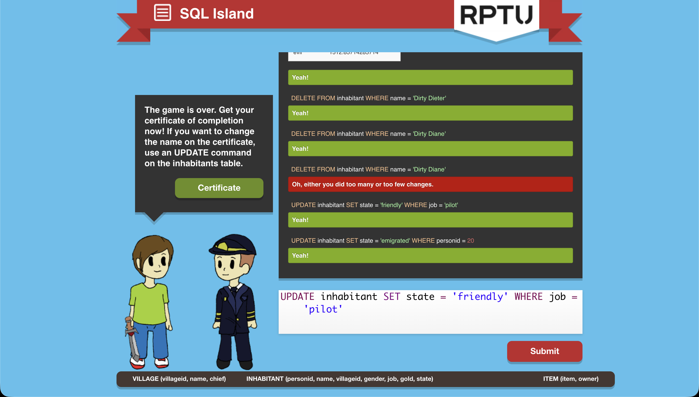

# Module 1, Task 5 — SQL Island

**Game:** [SQL Island](https://sql-island.informatik.uni-kl.de/)
**Played in class:** ~30 min
**Finished at home:**

## 1. What have you learned about databases and SQL so far, just by playing?

I learned how to retrieve data from the tables I needed. I learned how to update, remove, and add information in a table using SQL. I observed that it was much like giving instructions to get the info I need. 

## 2. Which SQL commands and patterns did you actually use?

I used SELECT FROM, WHERE conditions, OR and AND, UPDATE SET, DELETE FROM, INSERT INTO, ORDER BY, SUM, AVG, and GROUP BY.

## 3. In your own words — what is a table, a row, a column, and a query?

- **Table:** A table is an organized form of information that has fields (columns) and details (rows).
- **Row:** A row is one complete entry in the table; it holds exactly one value for each column.
- **Column:** A column is basically the topic/field that the information in rows is assigned to.
- **Query:** A query is basically a request to find, delete, add, or update information in the table.

## 4. What surprised you? What is still confusing?

What surprised me is the correlation between village.chief and inhabitant.personid, which are equal. Because of that, I learned about primary keys and foreign keys. I think what confused me is the order in which I should put the conditions and stuff in.

## Screenshot

