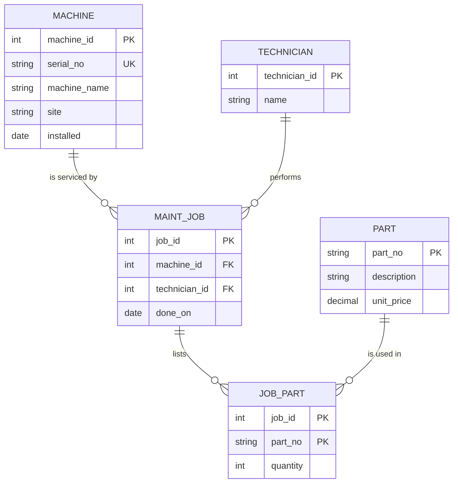

# Module 2 — ER Audit of `legacy.db`

[← Module 2](./README.md) · [Portfolio home](../README.md) · [Course module](https://github.com/iotempire/iotempire-teaching/blob/main/full-classes/hsbi-databases-10d/modules/02-data-contracts-and-legacy-schemas.md)

Proves **learning goal 1** (reconstruct the ER/EER model), **goal 2** (find integrity defects with queries) and **goal 3** (entity vs. attribute, natural vs. surrogate key — justified).

All counts below come from [`run-audit.py`](./run-audit.py); full output in [`audit-results.txt`](./audit-results.txt). Rebuild from scratch:

```sh
sqlite3 module-02/legacy.db < module-02/setup-legacy.sql
uv run python module-02/run-audit.py | tee module-02/audit-results.txt
```

---

## 1. Entities the schema *meant* to model

The legacy schema has three tables. The model behind it has **four entities and one junction**.

| Entity | Where it lives now | Attributes | Intended primary key |
|---|---|---|---|
| `Machine` | `machine` table | machine_name, serial_no, site, installed | `serial_no` (natural) or a surrogate `machine_id` — see §4 |
| `Part` | `part` table | part_no, description, unit_price | `part_no` (natural) |
| `MaintenanceJob` | `maint_job` table | job_id, technician, done_on | `job_id` (surrogate, already present but not declared) |
| `Technician` | **nowhere** — a TEXT column on `maint_job` | name | — needs one; see §4 |
| `JobPart` (junction) | **nowhere** — hidden in `maint_job.parts_used` | job_id, part_no | composite (job_id, part_no) |

Two of the five have no table at all. That is the core finding of the audit: the schema models three of the things the business cares about and buries the other two inside text columns.

## 2. The reconstructed ER model



Read the crow's feet: a machine has **zero or more** jobs (ring + foot — proven below, two machines have none), and a job belongs to **exactly one** machine.

## 3. Cardinalities — proven by counting, not assumed

### 3.1 The m:n relationship hidden in a text column

```sql
SELECT job_id, parts_used,
       CASE WHEN parts_used IS NULL THEN 0
            ELSE LENGTH(parts_used) - LENGTH(REPLACE(parts_used, ',', '')) + 1
       END AS n_parts
FROM maint_job;
```

```
  job_id | parts_used    | n_parts
  -------+---------------+--------
  1      | P-1001,P-1002 | 2
  2      | P-1003        | 1
  3      | P-1001        | 1
  4      | NULL          | 0
```

**Finding:** `n_parts` reaches 2, and `P-1001` appears in both job 1 and job 3. Many parts per job *and* many jobs per part — an **m:n relationship stored as a string**. A column cannot hold a relationship, so this needs the `job_part` junction table.

### 3.2 Is the machine→job relationship really 1:n?

```sql
SELECT machine_name, COUNT(*) AS jobs
FROM maint_job GROUP BY machine_name ORDER BY jobs DESC;
```

```
  machine_name | jobs
  -------------+-----
  cnc-01       | 2
  cnc-05       | 1
  cnc-02       | 1
```

**Finding:** `cnc-01` has 2 jobs → **1:n confirmed**. But only 3 machine names appear across 4 machine rows, so `cnc-03` and `RANDOM-NAME` have **zero** jobs. Participation on the machine side is **optional**, not total — the minimum cardinality is 0, which is why the diagram shows a ring and not a bare dash. `cnc-05` is the orphan (§5, defect 1).

### 3.3 Does `machine_name` work as a key at all?

```sql
SELECT (SELECT COUNT(*) FROM machine)                       AS machine_rows,
       (SELECT COUNT(DISTINCT machine_name) FROM machine)   AS distinct_machine_names,
       (SELECT COUNT(DISTINCT machine_name) FROM maint_job) AS names_used_by_jobs;
```

```
  machine_rows | distinct_machine_names | names_used_by_jobs
  -------------+------------------------+-------------------
  4            | 4                      | 3
```

**Finding:** 4 rows, 4 distinct names — `machine_name` happens to be unique *in this sample*. Nothing enforces that, so it is unique by luck, not by constraint. Contrast `part_no` in §5 defect 2, where the same luck ran out.

### 3.4 What the schema models vs. hides

| | Status in the legacy schema |
|---|---|
| **1:1** | Not modelled at all. No 1:1 relationship exists here — the `machine`/nameplate example from Task B has no counterpart in this database. |
| **1:n** | **Hidden.** Machine→Job exists in intent but is implemented as a TEXT name, not a foreign key, so the database does not know about it. |
| **m:n** | **Hidden, and worse.** Job↔Part lives inside one comma-separated column, which violates 1NF and makes the relationship unqueryable by SQL. |

## 4. Entity vs. attribute, natural vs. surrogate — the judgment calls

> **These are decisions, not facts.** The data below constrains them but does not settle them.
> Write your own answer under each — this is the part of goal 3 that says *justify*.

### 4.1 Is `technician` an entity or an attribute?

```sql
SELECT technician, COUNT(*) AS jobs
FROM maint_job GROUP BY technician ORDER BY jobs DESC;
```

```
  technician | jobs
  -----------+-----
  Beier      | 2
  Werther    | 1
  Klaas      | 1
```

**What the data shows:** 3 distinct technicians across 4 jobs — `Beier` recurs. A value that repeats across rows and has a life outside any single job is behaving like an entity, not a per-job detail. There is also nowhere to record anything *about* Beier (certifications, shift, employee number) without repeating it on every job row.

**My answer and why:**

I would model `technician` as a separate entity because the same technician can perform multiple jobs, and information such as certifications or employee numbers should be stored only once. A separate table also allows each job to reference a valid technician through a foreign key.

### 4.2 Natural or surrogate key for `Machine`?

**What the data shows:** `serial_no` is unique across all 4 rows and is real-world data (goal 3's "natural key"). `machine_name` is also unique here, but it is the *shop-floor label* — the kind of thing that gets renamed. `RANDOM-NAME` in the data is evidence that names get entered carelessly.

**My answer and why:**

Instead of using `serial_no` as the primary key, I'd use a surrogate `machine_id`. I'm avoiding `serial_no` as a primary key because serial numbers can change, which would break all referencing foreign keys. AND long strings take up more storage and slow down joins across foreign keys. So, use `machine_id` as the primary key, but keep `serial_no` under a `UNIQUE` constraint to still prevent duplicate serial numbers safely. 

### 4.3 Natural or surrogate key for `Part`?

**What the data shows:** `part_no` is the natural key the designer intended — but it has a **duplicate row** (§5 defect 2), so it is currently not a key at all. Declaring it `PRIMARY KEY` would have rejected that insert.

**My answer and why:**

I'd use `part_no` as the natural primary key. Because it's short, stable, and easy to shop floor technicians to read straight from shelf labels. And unlike machine serial numbers, part numbers are managed internally and never re-issued. I'd remove duplicate `P-1003` entries before applying the constraint. A primary key constraint would have blocked those duplicates from being inserted in the first place.

## 5. Integrity defects — proven, with production impact

Full query text and timings in [`audit-results.txt`](./audit-results.txt).

### Defect 1 — orphan maintenance jobs

```
  job_id | machine_name
  -------+-------------
  3      | cnc-05
```

Job 3 references `cnc-05`, which does not exist in `machine`. Nothing stopped the insert because `machine_name` is a TEXT column, not a foreign key.

**Production impact:**

Job 3 cannot be reliably linked to a machine, so reports about which parts were replaced on that machine may omit the job or its maintenance history.

### Defect 2 — duplicate natural key

```
  part_no | copies
  --------+-------
  P-1003  | 2
```

**Production impact:**

The duplicate `P-1003` creates ambiguity about which part record is correct and can cause inventory, pricing, and maintenance reports to double-count the same part.

### Defect 3 — `unit_price` stored as TEXT

This one is worth running both ways. The module's query:

```sql
SELECT part_no, unit_price FROM part WHERE unit_price < '15';
```

```
  part_no | unit_price
  --------+-----------
  P-1001  | 12.50
```

One row. Now the same question asked numerically:

```sql
SELECT part_no, unit_price FROM part WHERE CAST(unit_price AS REAL) < 15.0;
```

```
  part_no | unit_price
  --------+-----------
  P-1001  | 12.50
  P-1003  | 9.90
  P-1003  | 9.90
```

**Three** rows. The text comparison silently dropped the coolant filter at 9.90 — because in string ordering `'9.90' > '15'`: the comparison is made character by character, and `'9'` sorts after `'1'`. The cheapest part in the catalogue is excluded from a query asking for cheap parts, and no error is raised.

**Production impact:**

Price comparisons can exclude cheaper parts, leading to incorrect purchasing decisions and inaccurate cost calculations.

### Defect 4 — `installed` dates that are not dates

```
  machine_name | installed
  -------------+----------
  RANDOM-NAME  | unknown
```

**Production impact:**

The value `unknown` prevents reliable calculations of machine age and can make maintenance scheduling and warranty checks inaccurate.

### Defect 5 — the naive join on the comma list

```sql
SELECT j.job_id, p.description
FROM maint_job j
JOIN part p ON p.part_no = j.parts_used;
```

```
  job_id | description
  -------+------------------
  2      | Coolant filter
  2      | Coolant filter
  3      | Ball bearing 6203
```

Two things happen here, and **the module's comment only predicts one of them**:

1. **Job 1 vanishes.** Its `parts_used` is `'P-1001,P-1002'`, which equals no `part_no`, so the multi-part job — the only one that actually needed the m:n relationship — silently disappears.
2. **Job 2 is double-counted.** It appears twice, because `P-1003` has a duplicate row in `part`. Defect 2 is *multiplying through the join*.

So a query that looks like it worked returns 3 rows: one job lost, one job counted twice, and exactly one row correct. Defects compound — and the join reports success while doing it.

**Production impact:**

The join loses multi-part jobs and duplicates other jobs, producing unreliable maintenance reports and potentially incorrect replacement-part and cost records.

## 6. Summary — what the audit found

The audit found that the legacy database has missing entities, unenforced relationships, duplicate part numbers, incorrectly typed data, and invalid dates. The corrected model should contain five entities; `Machine`, `Technician`, `MaintenanceJob`, `Part`, and the `JobPart` junction table, with primary keys, foreign keys, and appropriate constraints. These changes would make relationships reliable and prevent invalid or duplicate records from entering the database. Without them, maintenance reports can omit jobs, double-count parts, and calculate costs incorrectly, leading to poor operational and purchasing decisions.
