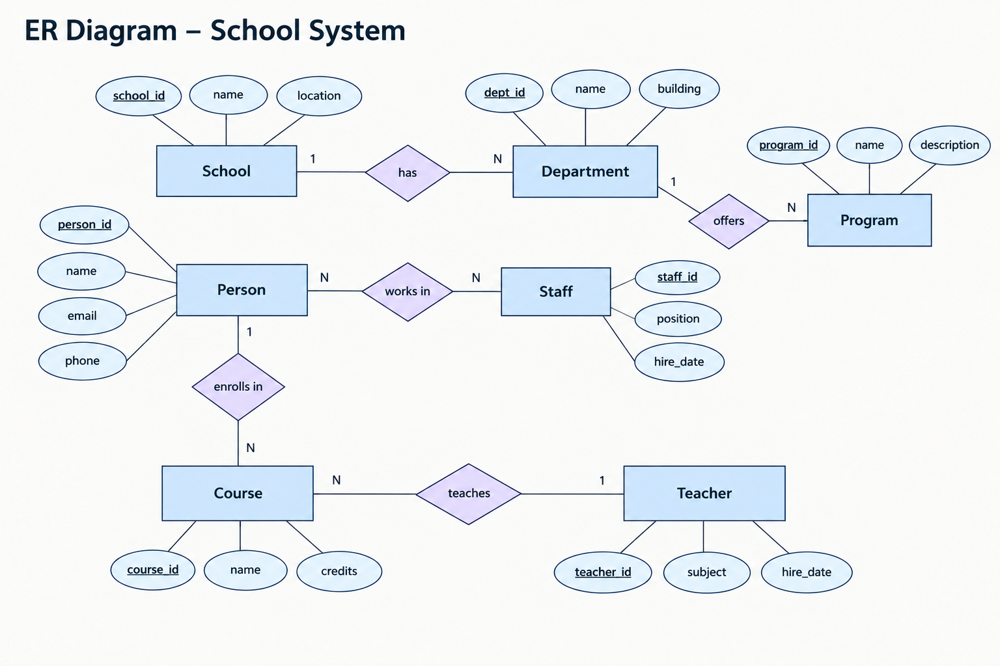
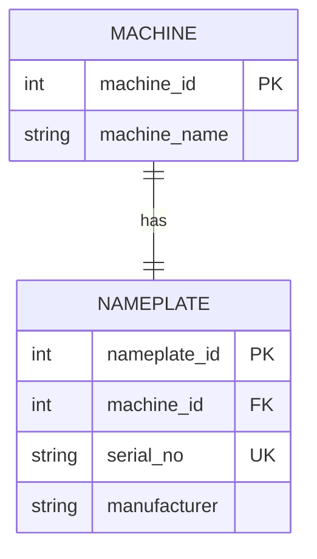
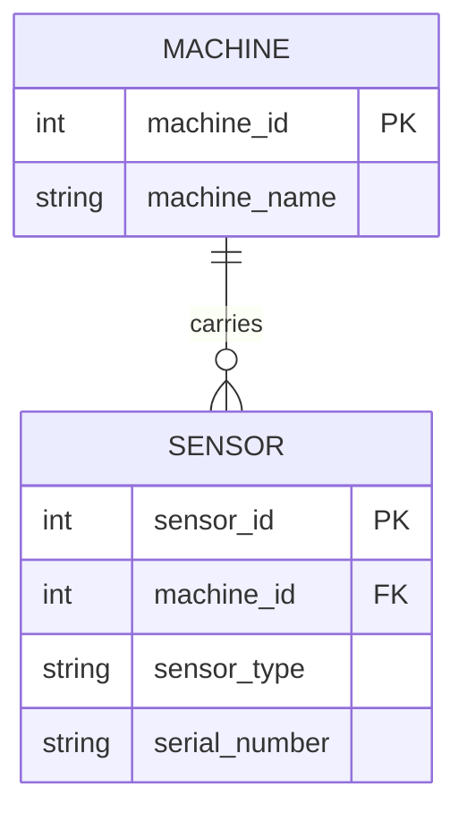
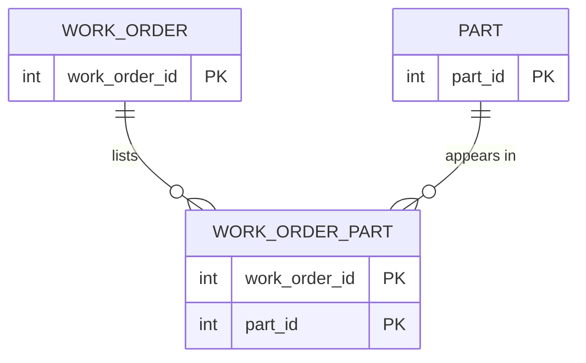
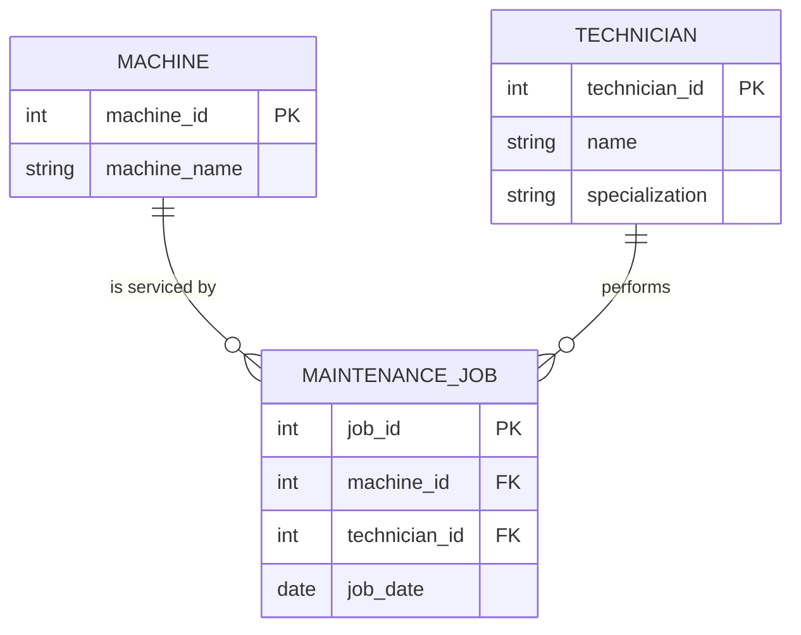

# Module 2 — Study Log

[← Portfolio home](../README.md) · [Module 2 README](./README.md) · [Course module](https://github.com/iotempire/iotempire-teaching/blob/main/full-classes/hsbi-databases-10d/modules/02-data-contracts-and-legacy-schemas.md)

> Task A (~30 min pod study), Task B (four sketches), Task C (pod-pair exchange).
> Pod: Lyon Tadeo, Mahmoud Gaber, Mahmoud Agbo · Date: 15.10.2026

---

## 1. References I used

> The source, and **the one concept I understood best from it**. Credit first.

| Source (link / book / video) | The one thing it taught me |
|---|---|
| [Entity-relationship model wiki](https://en.wikipedia.org/wiki/Entity%E2%80%93relationship_model) | Learned about Cardinality, Entities (a real-world object, place, person, or concept that has an independent existence and about which you want to store data), Entity types (the category/template that , Entity sets, and relations. |
| [Enhanced entity-relationship model wiki](https://en.wikipedia.org/wiki/Enhanced_entity%E2%80%93relationship_model) | Learned that EER is basically the upgraded version of the original ER diagram that we use to design databases. It adds superclasses/subclasses, inheritance, specialization, generalization, and more. |
| [Surrogate Key wiki](https://en.wikipedia.org/wiki/Surrogate_key) | Learned that a surrogate key is an ID number that a system makes up just to tell records apart. |
| [Natural Key wiki](https://en.wikipedia.org/wiki/Natural_key) | Learned that a natural key identifies something using information that *already* exists in the real world and actually means something. |
| [First normal form](https://en.wikipedia.org/wiki/First_normal_form) | Learned that 1NF means “one box, one value, no lists.” |
| [Why SQLite foreign keys are off by default](https://sqlite.org/foreignkeys.html) | Learned the reason why SQLite foreign keys are off by default is backwards compatibility. SQLite basically didn’t want to break old apps. |

---

## 2. Things I googled

> One line each: the term or question, what I found, the URL.

| What I searched | What I found | Source |
|---|---|---|
| "what is an entity type in database" | In a database, it's a category or blueprint for a group of similar real-world objects or concepts (such as Customer, Product, or Employee) that share the same attributes. | AI overview |
| "what is entity in database" | It represents a real-world object or concept that can be uniquely identified and stored in a database. It forms the foundation of data modeling in an Entity-Relationship (ER) model. | [Entity in DBMS](https://www.geeksforgeeks.org/dbms/entity-in-dbms/) |

---

## 3. Remarkable things

> Surprises, "aha"s, counterexamples. The module's own example: *"a name looked like a key but had duplicates."*

- It clicked in my head when i learned that surrogate keys are just ID numbers that a system makes up just to tell records apart, while natural keys give it real world attributes. I asked Claude to give me an everyday example for surrogate keys and natural keys and it told me "You hand your jacket over at a club, and the attendant gives you a ticket with #47 on it." It has no connection to the actual jacket; just an ID. Claud compared it to natural keys, saying "...something real about them, like 'black leather jacket, size M.' That breaks quickly. Two people might have the same jacket, and the description could change if you spill something on it."

---

## 4. LLM Q&A

> For each prompt: the prompt, a 2–3 line summary of the answer, and **how I verified it** — including where it was wrong, vague, or over-confident.

### Prompt 1

**Prompt: "could you give me a everyday life example on what a surrogate key is"**

**Answer (2–3 lines): A surrogate key is a system-generated, unique identifier assigned to a record that carries no real-world meaning. Unlike natural keys, such as descriptions or email addresses that can change or duplicate. Surrogate keys provide a stable, permanent way to track data. Common examples include database auto-increment IDs, student ID numbers, and coat check tickets.**

**How I verified it: Read it on wikipedia.**

**Where it was wrong / vague / over-confident: It wasn't any of those.**

### Prompt 2

**Prompt: "could you give me a everyday life example on what a natural key is"**

**Answer (2–3 lines): A natural key identifies a record using real world information that carries inherent meaning, such as an email address or license plate. Although intuitive, these identifiers can change over time, which requires updating linked records. To avoid this weakness, databases typically rely on surrogate keys for primary identification while maintaining unique constraints on natural keys.**

**How I verified it: Confirmed it on wikipedia.**

**Where it was wrong / vague / over-confident: It wasn't any of those.**

### Prompt 3

**Prompt: "could you give me a everyday life example on what entity/attribute/relationship/cardinality are"**

**Answer (2–3 lines): Database design uses four core concepts illustrated by a library setting where entities represent distinct objects like members and books, attributes describe their properties, and relationships define how they connect. Cardinality specifies how many instances relate to each other, such as a single member borrowing multiple books.**

**How I verified it: Searched on google and read the AI overview. It matched.**

**Where it was wrong / vague / over-confident: It wasn't.**

### Prompt 4

**Prompt:** Not mine — Aron asked ChatGPT to generate an ER diagram for a school system, and shared the result with the pod. I took it as a claim to check.

**Answer (2–3 lines):** A Chen-notation ER diagram with School, Department, Program, Person, Staff, Teacher and Course, with cardinality labels on every relationship and underlined primary keys throughout.

**How I verified it:** I checked each relationship's cardinality against what the entity names imply, and checked whether every entity was really a separate thing.

**Where it was wrong / vague / over-confident:** Wrong in two places. `enrolls in` is labelled 1:N when student enrolment is many-to-many. And `Person`, `Staff` and `Teacher` are modelled as three independent entities when Staff and Teacher are roles a Person fills — an inheritance case, not three tables joined by relationships. The diagram is confident and well-drawn, which is what made the errors easy to miss.

---

## 5. Two best found ER sketches

> Hunt for example sketches, then compile down to the best **two**. For each: source/credit, the image (screenshot or my own redraw), and **what it taught me that the others did not show**.

### Sketch 1 — UpGrad ER Diagram

- **Source: [Master ER Diagram in DBMS: A Guide to Database Design & Management](https://www.upgrad.com/blog/er-diagram-in-dbms/)**
- **Image:** 
- **What it showed me that others did not: This is not an ER diagram. It's a concept illustration, and its nested circles are arguably misleading, since relationships do not contain attributes and attributes do not contain entities. I include it because it is what made the three terms stick, not as an example of ER notation.**

### Sketch 2 — Aron's School System ER Diagram

- **Source:** Generated with ChatGPT by Aron (not my pod partner). I did not write the prompt.
- **Image:** 
- **What it showed me that others did not:** This was my clearest example of **Chen notation** — rectangles for entities, diamonds for relationships, ovals for attributes, underlined primary keys, and 1/N labels on the relationship lines. The other diagrams I found used crow's-foot, where relationships are just lines, so seeing attributes hanging off a relationship-capable notation made the difference between the two styles concrete.

It also turned out to be a good example for a second reason: **the notation is correct but the model is not.** Checking it against what I had learned, I found three problems:

  1. `Person —1— enrolls in —N— Course` says one person enrols in many courses, but that each course holds only one person. Enrolment is many-to-many, so this needs a junction, exactly like `work_order_part` in my Task B sketch 6.3.
  2. `Person`, `Staff` and `Teacher` are drawn as three separate entities with three separate IDs. A teacher is staff and staff are people — these are roles one person plays, which is EER generalization, not three things joined by relationships. As drawn, one human would need a `person_id`, a `staff_id` and a `teacher_id`.
  3. `hire_date` appears on both `Staff` and `Teacher`, which is the duplication problem 2 causes.

So the diagram taught me the notation and then demonstrated why you check a model against the rules rather than trusting that it looks professional.

---

## 6. Task B — four sketches from words

> Entities, attributes, relationships + cardinality for each description, then a sketch.

### 6.1 — 1:1 · machine ↔ nameplate

- **Entities / attributes:**
  - `Machine` — machine_id (PK), machine_name
  - `Nameplate` — nameplate_id (PK), machine_id (FK, UNIQUE), serial_no, manufacturer

- **Cardinality and where the key goes:** This is a strict one-to-one relationship where every record on both sides must have a match. You can put the connecting link on either table; for example, putting the machine ID on the nameplate table. Adding a "unique" rule to that ID is crucial because it ensures a nameplate can only belong to one machine, preventing multiple machines from sharing the same one.

- **Separate entity or just an attribute? Why:** Separate entity. A machine's nameplate can be changed or replaced over time, and the factory needs to track that change separately from the machine. Because you can swap it out and track it on its own, it gets its own table.

- **Sketch:**



### 6.2 — 1:n · machine → sensors
 
- **Entities / attributes:**
  - `machine` - machine_id (PK), machine_name
  - `sensor` - sensor_id (PK), machine_id (FK), sensor_type, serial_number
 
- **Cardinality and where the foreign key goes:** This is a one-to-many relationship where a single machine can have many sensors, but each sensor is installed on exactly one machine. Because of this, the connecting link (`machine_id`) must go on the **Sensor** table. You do **not** add a unique rule to this ID, which is what allows multiple different sensors to share and point to the same machine.
 
- **Sketch:**



### 6.3 — m:n · work orders ↔ parts

- **Entities / attributes:**
  - `work order` - work_order_id (PK)
  - `part` - part_id (PK)
  - `work order part` - work_order_id (FK), part_id (FK)
    
- **Junction table and its key:** This is a many-to-many relationship, so you need a junction table (such as Work Order Part). Its primary key is a composite key made up of both `work_order_id` and `part_id`. This combination ensures that a specific part can only be listed once on a single work order, while still allowing parts to be used across many different orders.
  
- **How "an order lists a part only once" is enforced:** This rule is enforced by making the combination of `work_order_id` and `part_id` the composite primary key (or a unique constraint) of the junction table. Because a primary key combination must be entirely unique, the database will automatically reject any attempt to insert a duplicate row for the same part on the same work order.
  
- **Sketch:**



### 6.4 — entity vs. attribute vs. relationship · maintenance job

- **Entities / attributes:**
  - `machine` - machine_id (PK), machine_name
  - `technician` - technician_id (PK), name, specialization
  - `maintenance job` - job_id (PK), job_date, machine_id (FK), technician_id (FK)

- **Is the job a relationship or an entity? My answer and why:** The job is an entity. Even though the job links a machine and a technician, it has its own details (like an ID and dates) and represents a real event the factory needs to track. In database design, actions or events that connect different things and collect data are treated as full entities instead of simple connection lines.

- **Is the technician an entity or just a name? My answer and why:** The technician is an entity. Because a technician performs many jobs and has an independent identity that needs to be tracked across multiple events. If a technician were just a name, it would simply be a text attribute living inside the job table. However, since multiple jobs can be tied to the exact same person, they require their own separate table so the system can track them properly.

- **Sketch:**



### 6.5 — The proof

> `CREATE TABLE` for my favourite sketch, two inserted rows, and the `COUNT` query that demonstrates the cardinality.

```sql

```

**Result:**

```

```

**What this proves:**

---

## 7. Agreed learning (pod discussion)

> Task C. The 3–5 points both pods stand behind, what I learned from the other pod, and any disagreement we left open.

**Pod we paired with:** I was not yet assigned to a Task Pod for this session, so I worked with Rayan and Aron. We then paired with a neighbouring pod for the exchange.
<!-- TODO: add the names of the neighbouring pod members once I have them. -->

**Agreed points:**

1. **Entities** — what counts as a thing with independent existence, and where the line falls between an entity and an attribute that merely describes one.
2. **Relationships** — that a relationship is the link between entities, read in both directions, and that the verb in a description is what signals one.
3. **Cardinality** — how many instances relate to how many, and that it has to be stated in both directions rather than assumed from one side.

**What I changed in this log after the exchange:** Nothing. The discussion confirmed the model my group had already arrived at rather than correcting it.

**Disagreement we left open:** None. Both pods converged on the same reading of entities, relationships and cardinality.

**Image we posted in Discord:** [Aron's ER Diagram](https://discord.com/channels/1064132619735928932/1560197797364502559/1560207494683566152) — chosen because: We both understood entities, relations, and attributes better after seeing this.
