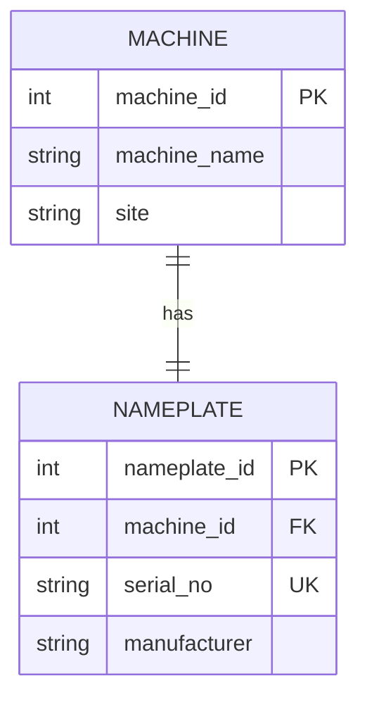

# Module 2 — Study Log

[← Portfolio home](../README.md) · [Module 2 README](./README.md) · [Course module](https://github.com/iotempire/iotempire-teaching/blob/main/full-classes/hsbi-databases-10d/modules/02-data-contracts-and-legacy-schemas.md)

> Task A (~30 min pod study), Task B (four sketches), Task C (pod-pair exchange).
> Pod: Lyon Tadeo, Mahmoud Gaber, Mahmoud Agbo · Date: 15.10.2026

---

## 1. References I used

> The source, and **the one concept I understood best from it**. Credit first.

| Source (link / book / video) | The one thing it taught me |
|---|---|
| [Entity-relationship model wiki](https://en.wikipedia.org/wiki/Entity%E2%80%93relationship_model) | Learned about Cardinality, Entities (a real-world object, place, person, or concept that has an independent existence and about which you want to store data), Entity types (the category/template that , Entity sets, and relations. |
| [Enhanced entity-relationship model wiki](https://en.wikipedia.org/wiki/Enhanced_entity%E2%80%93relationship_model) | Learned that EER is basically the upgraded version of the original ER diagram that we use to design databases. It adds superclasses/subclasses, inheritance, specialization, generalization, and more. |
| [Surrogate Key wiki](https://en.wikipedia.org/wiki/Surrogate_key) | Learned that a surrogate key is an ID number that a system makes up just to tell records apart. |
| [Natural Key wiki](https://en.wikipedia.org/wiki/Natural_key) | Learned that a natural key identifies something using information that *already* exists in the real world and actually means something. |
| [First normal form](https://en.wikipedia.org/wiki/First_normal_form) | Learned that 1NF means “one box, one value, no lists.” |
| [Why SQLite foreign keys are off by default](https://sqlite.org/foreignkeys.html) | Learned the reason why SQLite foreign keys are off by default is backwards compatibility. SQLite basically didn’t want to break old apps. |

---

## 2. Things I googled

> One line each: the term or question, what I found, the URL.

| What I searched | What I found | Source |
|---|---|---|
| "what is an entity type in database" | In a database, it's a category or blueprint for a group of similar real-world objects or concepts (such as Customer, Product, or Employee) that share the same attributes. | AI overview |
| "what is entity in database" | It represents a real-world object or concept that can be uniquely identified and stored in a database. It forms the foundation of data modeling in an Entity-Relationship (ER) model. | [Entity in DBMS](https://www.geeksforgeeks.org/dbms/entity-in-dbms/) |

---

## 3. Remarkable things

> Surprises, "aha"s, counterexamples. The module's own example: *"a name looked like a key but had duplicates."*

- It clicked in my head when i learned that surrogate keys are just ID numbers that a system makes up just to tell records apart, while natural keys give it real world attributes. I asked Claude to give me an everyday example for surrogate keys and natural keys and it told me "You hand your jacket over at a club, and the attendant gives you a ticket with #47 on it." It has no connection to the actual jacket; just an ID. Claud compared it to natural keys, saying "...something real about them, like 'black leather jacket, size M.' That breaks quickly. Two people might have the same jacket, and the description could change if you spill something on it."

---

## 4. LLM Q&A

> For each prompt: the prompt, a 2–3 line summary of the answer, and **how I verified it** — including where it was wrong, vague, or over-confident.

### Prompt 1

**Prompt: "could you give me a everyday life example on what a surrogate key is"**

**Answer (2–3 lines): A surrogate key is a system-generated, unique identifier assigned to a record that carries no real-world meaning. Unlike natural keys, such as descriptions or email addresses that can change or duplicate. Surrogate keys provide a stable, permanent way to track data. Common examples include database auto-increment IDs, student ID numbers, and coat check tickets.**

**How I verified it: Read it on wikipedia.**

**Where it was wrong / vague / over-confident: It wasn't any of those.**

### Prompt 2

**Prompt: "could you give me a everyday life example on what a natural key is"**

**Answer (2–3 lines): A natural key identifies a record using real world information that carries inherent meaning, such as an email address or license plate. Although intuitive, these identifiers can change over time, which requires updating linked records. To avoid this weakness, databases typically rely on surrogate keys for primary identification while maintaining unique constraints on natural keys.**

**How I verified it: Confirmed it on wikipedia.**

**Where it was wrong / vague / over-confident: It wasn't any of those.**

### Prompt 3

**Prompt: "could you give me a everyday life example on what entity/attribute/relationship/cardinality are"**

**Answer (2–3 lines): Database design uses four core concepts illustrated by a library setting where entities represent distinct objects like members and books, attributes describe their properties, and relationships define how they connect. Cardinality specifies how many instances relate to each other, such as a single member borrowing multiple books.**

**How I verified it: Searched on google and read the AI overview. It matched.**

**Where it was wrong / vague / over-confident: It wasn't.**

---

## 5. Two best found ER sketches

> Hunt for example sketches, then compile down to the best **two**. For each: source/credit, the image (screenshot or my own redraw), and **what it taught me that the others did not show**.

### Sketch 1 — UpGrad ER Diagram

- **Source: [Master ER Diagram in DBMS: A Guide to Database Design & Management](https://www.upgrad.com/blog/er-diagram-in-dbms/)**
- **Image:** [UpGrad ER Diagram](UpGrad_ER_Diagram.avif)
- **What it showed me that others did not: It helped me understand these database concepts easier by showing them as layers that build outward, starting with the core entities at the center, adding their details as attributes, and finally connecting them all together**

### Sketch 2 — Aron's School System ER Diagram

- **Source: Aron's ChatGPT**
- **Image:** [School System ER Diagram](School_System_ER_Diagram.png)
- **What it showed me that others did not: This solidified my understanding of these concepts since it gave information on the relation between the entities.**

---

## 6. Task B — four sketches from words

> Entities, attributes, relationships + cardinality for each description, then a sketch.

### 6.1 — 1:1 · machine ↔ nameplate

- **Entities / attributes:**
  - `Machine` — machine_id (PK), machine_name, site
  - `Nameplate` — nameplate_id (PK), machine_id (FK, UNIQUE), serial_no, manufacturer

- **Cardinality and where the key goes:** 1:1, total participation both sides
  (`||--||`). The foreign key can sit on either side; `machine_id` goes on
  `Nameplate` with a `UNIQUE` constraint. The UNIQUE is what makes it 1:1 —
  without it, two machines could claim the same nameplate and it degrades to 1:n.

- **Separate entity or just an attribute? Why:** Separate entity. A nameplate can
  be re-stamped or replaced during the machine's life, and the plant needs to be
  able to record that independently of the machine itself. A thing that can be
  swapped out and tracked on its own has its own existence, so it gets its own table.

- **Sketch:**



### 6.3 — m:n · work orders ↔ parts

- **Entities / attributes:**
- **Junction table and its key:**
- **How "an order lists a part only once" is enforced:**
- **Sketch:**

### 6.4 — entity vs. attribute vs. relationship · maintenance job

- **Is the job a relationship or an entity? My answer and why:**
- **Is the technician an entity or just a name? My answer and why:**
- **Sketch:**

### 6.5 — The proof

> `CREATE TABLE` for my favourite sketch, two inserted rows, and the `COUNT` query that demonstrates the cardinality.

```sql

```

**Result:**

```

```

**What this proves:**

---

## 7. Agreed learning (pod discussion)

> Task C. The 3–5 points both pods stand behind, what I learned from the other pod, and any disagreement we left open.

**Pod we paired with:**

**Agreed points:**

1.
2.
3.

**What I changed in this log after the exchange:**

**Disagreement we left open:**

**Image we posted in Discord:** _link_ — chosen because:
