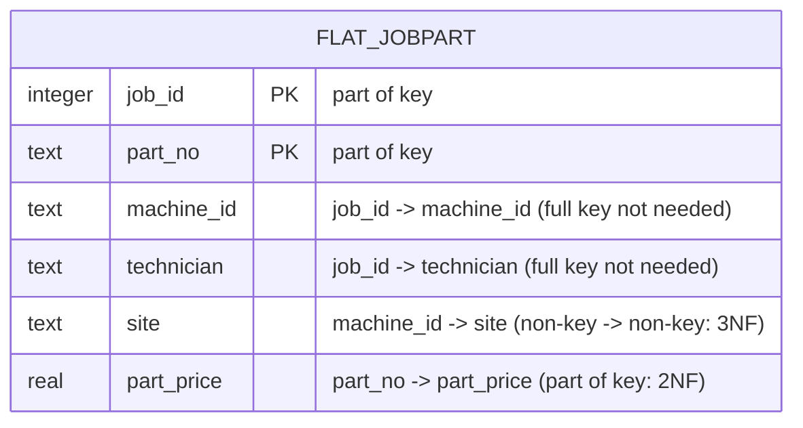
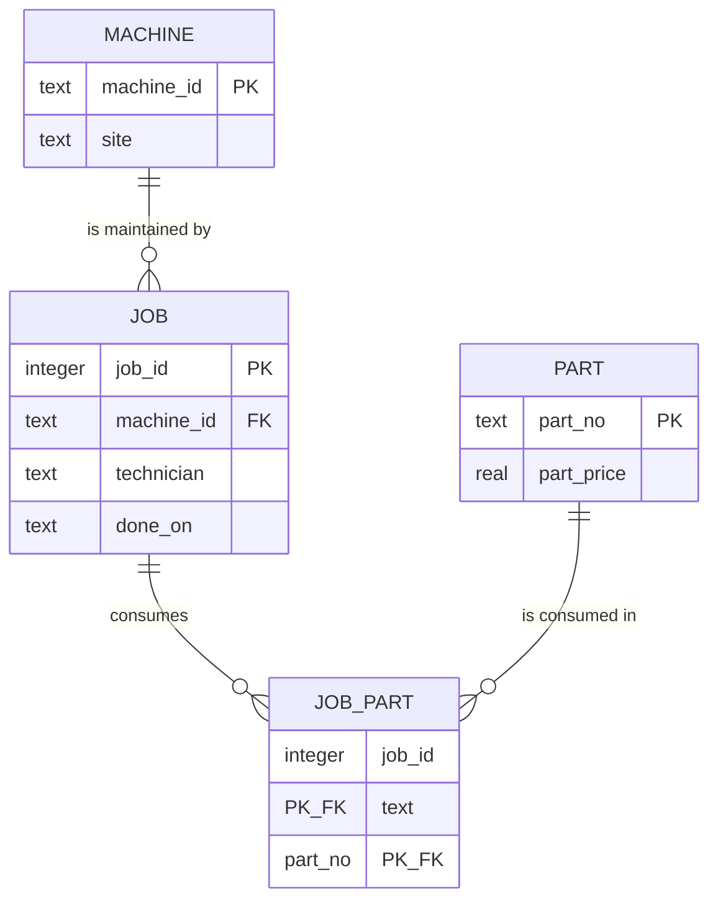

# Module 5 · Rounds 1–3 — dependencies, anomalies, and the 3NF build

[← Module 5 home](./README.md) · [Round 4 benchmark](./benchmark.md) · [Round 5 price](./price.md)

My notes for the three rounds that happen before anything is measured: what the
dependencies actually are, what breaks when you ignore them, and what the
decomposition did when I ran it.

Every number and every error message on this page comes out of
[`evidence.py`](./evidence.py) — see [`evidence.txt`](./evidence.txt) for the
raw transcript.

---

## 1 · See it — the dependencies in the five-row extract (Round 1)

The extract I was given:

| job_id | machine_id | site | technician | part_no | part_price |
|---|---|---|---|---|---|
| 1 | cnc-01 | Gütersloh | tech-0 | P-0001 | 6.00 |
| 1 | cnc-01 | Gütersloh | tech-0 | P-0002 | 7.00 |
| 2 | cnc-02 | Gütersloh | tech-1 | P-0001 | 6.00 |
| 2 | cnc-02 | Gütersloh | tech-1 | P-0003 | 8.50 |
| 3 | cnc-01 | Gütersloh | tech-0 | P-0003 | 8.50 |

### 1.1 The FD list, with the evidence for each one marked

| # | Dependency | Status | Why I classified it that way |
|---|---|---|---|
| 1 | `job_id → machine_id` | **domain** | A maintenance job is carried out on one machine. If a job touched two machines it would be two jobs. |
| 2 | `job_id → technician` | **domain** | One job, one person who signed it off. Note this is a *modelling decision*, not a law of nature — see §1.4. |
| 3 | `machine_id → site` | **domain** | A machine stands in one building. It can be *moved*, which is a change to the fact, not a second value. |
| 4 | `part_no → part_price` | **domain, with a caveat** | A part number has one list price *at a point in time*. See §1.4 — this is the one I would argue about. |
| 5 | `(job_id, part_no) → all other attributes` | **domain** | This is the candidate key. |
| 6 | `machine_id → technician` | **observed only** | cnc-01 → tech-0 in all three of its rows, cnc-02 → tech-1 in both of its. Five rows, two machines; nothing says a machine has a dedicated technician. |
| 7 | `technician → machine_id` | **observed only** | The same accident read backwards. |
| 8 | `part_price → part_no` | **observed only** | Three parts with three distinct prices, so the map happens to be invertible here. Give me a fourth part at 6.00 and it is gone. |
| 9 | `X → site` for *any* X | **observed, vacuously** | `site` has exactly one value in these five rows. Every dependency with `site` on the right holds trivially. This is the one I would not have caught by looking. |

**Candidate key: `(job_id, part_no)`.** Minimal: `job_id` alone fails (job 1 has two
rows), `part_no` alone fails (P-0001 appears under two jobs). Together they
identify a row and determine everything else. There is no second candidate key —
nothing else in the table is unique.

### 1.2 The two ER sketches

**As it is** — one relation, with the dependencies drawn as arrows *inside* it.
Only arrows 1–5 are real; the FDs that are not key-to-attribute are the defects:



Two arrows in that box are the whole module:

- `part_no → part_price` depends on **part of** the composite key → **2NF violation**.
- `machine_id → site` is a **non-key attribute determining another non-key
  attribute** → **3NF violation**.

**As it should be** — every arrow now starts at a whole primary key:



**My answer to the exchange question — "which arrow disappears in the second
one?"** Both of the arrows that did not start at a whole key. `machine_id → site`
is still a dependency, but it is now the *only* dependency in `MACHINE`, where
`machine_id` **is** the key; the same for `part_no → part_price` in `PART`. So
strictly, no arrow disappears from the model at all — the arrows stayed and the
**redundancy** disappeared, because each arrow is now stored in exactly one place
instead of once per fact row. That reframing is what I actually took from Round 1:
normalization does not delete dependencies, it relocates them to the table where
their left-hand side is the key.

What *does* disappear is the four-attribute dependency on a partial key. `JOB_PART`
has no non-key attributes left at all — it is pure relationship.

### 1.3 Diffing against an LLM's FD list

I asked for an FD list from the five rows without telling it which were domain
facts. The model returned seven dependencies. Four matched mine (1, 2, 3, 5).
Three did not:

| It claimed | I say | Who is right |
|---|---|---|
| `machine_id → technician` as a dependency | observed only | **Me.** Three rows of one machine is not a staffing policy. This is the exact failure the module predicts: five rows promoted into a rule. |
| `site → ...` relationships | vacuous here | **Me**, and this is the one worth keeping. A single-valued column makes *every* FD into it hold. A model reading rows cannot see that. |
| `part_no → part_price` as a flat domain fact | domain **with a caveat** | **It, mostly** — but it stopped one question too early. See below. |

The useful disagreement was the third one, and it went against me in an
interesting direction. `part_no → part_price` is the dependency the whole 2NF
story rests on, and it is **only true if price never changes**. The moment
Kortmann renegotiates with a supplier, the price of a part becomes a function of
`(part_no, date)`, not of `part_no` — and then normalizing `part_price` into
`part` is itself an error, because a job from January would silently be re-costed
at March's price. The 200k build in Round 3 bakes in the no-history assumption,
so every cost number on these pages is "costed at today's price", not "what it
cost".

That is not a defect in the decomposition. It is a **requirement the schema
forgot**, which is the same shape of finding as Module 2 — and I only got to it by
pushing on an FD I had already marked "domain" and moved on from.

### 1.4 The modelling decisions hiding inside the FD list

Two of the "domain" FDs are really choices, and the decomposition in Round 3
enforces them whether or not I meant them:

- **`job_id → technician`** says a job has exactly one technician. If two people
  work a job, this schema cannot record it without inventing a second job. §5
  below shows the decomposition *refusing* to load data that breaks this, which
  is the schema checking my model rather than the other way round.
- **`part_no → part_price`** says price has no history, as above.

---

## 2 · Break it — the three anomalies, with what actually happened (Round 2)

```sql
CREATE TABLE flat5(
  job_id INTEGER, machine_id TEXT, site TEXT,
  technician TEXT, part_no TEXT, part_price REAL
);
INSERT INTO flat5 VALUES
  (1,'cnc-01','Gütersloh','tech-0','P-0001',6.00),
  (1,'cnc-01','Gütersloh','tech-0','P-0002',7.00),
  (2,'cnc-02','Gütersloh','tech-1','P-0001',6.00),
  (2,'cnc-02','Gütersloh','tech-1','P-0003',8.50),
  (3,'cnc-01','Gütersloh','tech-0','P-0003',8.50);
```

### 2.1 Update anomaly — move cnc-01 to Bielefeld

```sql
UPDATE flat5 SET site = 'Bielefeld' WHERE machine_id = 'cnc-01';
```

**3 rows touched** for one fact about one machine. In the 3NF schema the same
change is `UPDATE machine SET site='Bielefeld' WHERE machine_id='cnc-02'` — one
row, always, whatever the job history looks like. Round 5 puts a number on that
gap at production scale: **1 row versus 4,000**.

The anomaly is not the row count by itself — it is that the row count makes the
change **interruptible**. Touch two of the three rows and stop:

```sql
UPDATE flat5 SET site = 'Bielefeld' WHERE machine_id = 'cnc-01' AND job_id = 1;
-- 2 rows
SELECT DISTINCT site FROM flat5 WHERE machine_id = 'cnc-01';
-- Bielefeld
-- Gütersloh
```

One machine, two sites, no error. The table is now lying and nothing in it knows.

**"What happens when two people do it in two sessions?"** — the question the
module asks, and the answer is sharper than I expected because of Module 1: SQLite
has **one writer**. The second session does not interleave; it blocks, or it gets
`SQLITE_BUSY`. So the classic textbook lost-update race cannot happen here the way
it does on a server. What *can* happen, and is worse because it looks like nothing:

- Writer A sets all three rows to Bielefeld. Writer B, who read the table before
  A ran, sets the two rows it knows about back to Gütersloh. Result: the split
  above, from two serialized, individually successful transactions.
- Or A's `UPDATE` is simply killed partway — a laptop lid, a full disk — outside an
  explicit transaction. Each statement is its own transaction, so SQLite will not
  leave a statement half-done, but a *loop* of per-row updates from an application
  absolutely can stop in the middle.

In 3NF neither is reachable: there is one row, and one row cannot disagree with
itself. That is the actual guarantee normalization buys — not "faster updates" but
**no partially-applied fact**.

### 2.2 Insert anomaly — record a part no job has used

I want to record that P-0009 exists and costs 12.00. There is no job for it yet.

```sql
INSERT INTO flat5(part_no, part_price) VALUES ('P-0009', 12.00);
```

It succeeds, and this is the anomaly:

```
(None, None, None, None, 'P-0009', 12.0)
```

A row with a `NULL` `job_id` — a job-part fact about no job. The table now has
6 rows of which 1 is not a job-part at all, so `SELECT COUNT(*) FROM flat5` is no
longer "how many parts were used". Every query over this table needs
`WHERE job_id IS NOT NULL` from now on, and the day someone forgets is the day the
dashboard double-counts.

The alternative is worse: invent a dummy job so the row has somewhere to live.
Then the *job* table lies instead.

In 3NF it is `INSERT INTO part VALUES ('P-0009', 12.00)` — a part is a thing that
exists on its own, so there is a table where it can exist on its own. **The insert
anomaly is the schema telling you an entity is missing.**

### 2.3 Delete anomaly — delete the last job that used a part

P-0002 costs 7.00, and exactly one job (job 1) has ever used it.

```sql
SELECT COUNT(*) FROM flat5 WHERE part_no = 'P-0002';   -- 1
DELETE FROM flat5 WHERE job_id = 1;                    -- 2 rows deleted
SELECT DISTINCT part_price FROM flat5 WHERE part_no = 'P-0002';
-- (no rows)
```

**The price of P-0002 is gone, and so is the knowledge that P-0002 exists.** I
deleted a job and lost a part from the catalogue. Nothing errored; the database is
internally consistent and permanently less informed.

This is the same defect as §2.2 seen from the other end — `part` has no table of
its own, so its existence is parasitic on there being a job that used it. The two
anomalies are one modelling error with two symptoms, and that is the thing I want
to remember from Round 2: **insert and delete anomalies always come in pairs**, because
both say "this entity has no home".

### 2.4 My answer to "try to break one of my three statements"

The honest weak one is §2.1. A neighbour could argue that `UPDATE … WHERE
machine_id='cnc-01'` is *not* an anomaly, because it does the right thing — all
three rows end up correct. They would be right about that statement. My answer is
that the anomaly is not in the statement I wrote but in the **class of statements
the schema allows**: the correct update and the inconsistent partial update are
both single legal `UPDATE`s, and the schema cannot distinguish them. In 3NF the
inconsistent one is not expressible.

---

## 3 · Build it — the 200k table (Round 3)

Built by [`setup.sql`](./setup.sql) §1. The data is generated from a `CROSS JOIN`
of two recursive counters, so it is fully reproducible — no seed, no randomness:

```sh
rm -f module-05/normalize.db
sqlite3 module-05/normalize.db ".read module-05/setup.sql"
```

| What | Value |
|---|---|
| `flat_jobpart` rows | **200,000** (20,000 jobs × exactly 10 parts) |
| distinct machines | 50 (`cnc-01` … `cnc-50`) |
| distinct sites | 2 — Bielefeld (1 machine), Gütersloh (49) |
| distinct technicians | 7 (`tech-0` … `tech-6`) |
| distinct parts | **10** |
| `done_on` range | 2026-01-01 → 2026-03-31, 90 distinct dates |
| build time | 0.83 s |

### 3.1 The decomposition, and the row-count check that proves it lossless

[`setup.sql`](./setup.sql) §2 extracts each dependency into the table where its
left-hand side is the key, then checks the join reproduces the original:

```sql
SELECT (SELECT COUNT(*) FROM flat_jobpart)  AS flat_rows,
       (SELECT COUNT(*) FROM job_part)      AS normalized_rows;
```

```
flat_rows   normalized_rows
200000      200000
```

| Table | Rows | Holds |
|---|---|---|
| `machine` | 50 | `machine_id → site` |
| `part` | 10 | `part_no → part_price` |
| `job` | 20,000 | `job_id → machine_id, technician, done_on` |
| `job_part` | 200,000 | the relationship, no attributes of its own |

200,000 = 200,000 says the decomposition is **lossless** on this data: no row was
dropped and none was duplicated. It does *not* prove the decomposition is correct
in general — a lossless-join decomposition is guaranteed when you split along a
functional dependency, and the check confirms I did that rather than proving I
could have.

### 3.2 Why `part` has 10 rows and not 40

The exchange question for this round, and it is a trap worth having fallen into.
The generator looks like it makes 40 parts:

```sql
'P-' || printf('%04d', (k % 40) + 1)
```

but `k` only ever runs **1 to 10**, so `k % 40` is just `k`, and the part numbers
are `P-0002` … `P-0011` — ten of them, and notably *not* starting at `P-0001`.
The `% 40` is dead code: it would matter only if the inner counter went past 40.

So the `10` in "20,000 jobs × exactly 10 parts" is doing two jobs at once — it is
the number of parts per job *and* the size of the whole catalogue, because every
job uses every part. That is also why `job_part`'s primary key never collides:
each job meets each part exactly once.

Prices follow `5 + k`, so **6.00 to 15.00**, which is the number to check if a
neighbour's `SUM` disagrees with mine.

### 3.3 `PRAGMA foreign_keys` — the Module 4 trap, twice

The `REFERENCES` clauses in [`setup.sql`](./setup.sql) are documentation unless the
connection asks for enforcement. Confirmed:

```
PRAGMA foreign_keys            -> 0            (default, per connection)
INSERT INTO job_part VALUES (999999,'P-9999')  -> accepted
PRAGMA foreign_key_check       -> 2 violations  (a missing job AND a missing part)
```

Two violations from one row, because the row dangles in two directions at once.

**Turned on, the decomposition still loads** — 200,000 `job_part` rows — because
`setup.sql` inserts parents before children (`machine`, `part`, `job`, then
`job_part`). The order was already right; with the pragma off I had no way to know
whether that was judgement or luck.

And then the part I did not expect, which cost me twenty minutes:

```
PRAGMA foreign_keys = OFF
BEGIN
PRAGMA foreign_keys = ON        -- no error
PRAGMA foreign_keys            -> 0       (!!)
INSERT INTO job_part VALUES (999998,'P-9998')  -> accepted
```

**`PRAGMA foreign_keys` is a no-op inside an open transaction, and it fails
silently.** It does not error, and reading it back gives you the value it did
*not* change to. My first attempt at this test had an implicit transaction open
from an earlier `INSERT` (Python's `sqlite3` opens one for you unless you set
`isolation_level=None`), so I measured "foreign keys are off even when they are
on" and believed it for a while.

That is the third variant of the same Module 4 lesson: a rule that lives in the
caller is a rule that will be forgotten. Here it is worse than forgotten — it can
be *set, confirmed, and still absent*.

### 3.4 `SELECT DISTINCT` is asserting something

`INSERT INTO job SELECT DISTINCT job_id, machine_id, technician, done_on FROM
flat_jobpart` quietly assumes each job has one technician. On this data it does. I
tested what happens when it does not, by adding a single row giving job 1 a second
technician:

```
rows DISTINCT would produce for job 1:  2
INSERT INTO job SELECT DISTINCT ...  -> IntegrityError: UNIQUE constraint failed: job.job_id
job rows after the failure:             0
```

The primary key refuses it, and — because the whole `INSERT … SELECT` is one
statement and therefore one transaction — **the entire 20,000-row load rolls
back**, not just the bad row.

Both halves of that matter. The refusal is the decomposition checking my model
(§1.4): the schema will not let me claim `job_id → technician` and store data that
contradicts it. The rollback is the operational cost of finding out this way —
one contradictory row in a 200,000-row extract and you load nothing, with an error
that names the constraint but not the row. A production loader would want the
offending `job_id`s first:

```sql
SELECT job_id, COUNT(DISTINCT technician) AS n
FROM flat_jobpart GROUP BY job_id HAVING n > 1;
```

That query is the acceptance test for the assumption, and it should run *before*
the decomposition, not after it fails.

---

[← Module 5 home](./README.md) · [Next: Round 4 — the benchmark →](./benchmark.md)
